

<picture><source media="(prefers-color-scheme: dark)" srcset="./assets/dark/header.svg" /></picture>

  

I like web development, UI/UX, and turning ideas into useful products. 
Always learning, occasionally overengineering.

  

<picture><source media="(prefers-color-scheme: dark)" srcset="./assets/dark/label-about.svg" /></picture>

  <picture><source media="(prefers-color-scheme: dark)" srcset="./assets/dark/card-location.svg" /></picture>
  <picture><source media="(prefers-color-scheme: dark)" srcset="./assets/dark/card-learning.svg" /></picture>
  <picture><source media="(prefers-color-scheme: dark)" srcset="./assets/dark/card-fun-fact.svg" /></picture>

 

<picture><source media="(prefers-color-scheme: dark)" srcset="./assets/dark/label-toolbox.svg" /></picture>

  <picture><source media="(prefers-color-scheme: dark)" srcset="./assets/dark/tags/python.svg" /></picture>
  <picture><source media="(prefers-color-scheme: dark)" srcset="./assets/dark/tags/java.svg" /></picture>
  <picture><source media="(prefers-color-scheme: dark)" srcset="./assets/dark/tags/c.svg" /></picture>
  <picture><source media="(prefers-color-scheme: dark)" srcset="./assets/dark/tags/cpp.svg" /></picture>
  <picture><source media="(prefers-color-scheme: dark)" srcset="./assets/dark/tags/javascript.svg" /></picture>
  <picture><source media="(prefers-color-scheme: dark)" srcset="./assets/dark/tags/typescript.svg" /></picture>

  <picture><source media="(prefers-color-scheme: dark)" srcset="./assets/dark/tags/html5.svg" /></picture>
  <picture><source media="(prefers-color-scheme: dark)" srcset="./assets/dark/tags/react.svg" /></picture>
  <picture><source media="(prefers-color-scheme: dark)" srcset="./assets/dark/tags/nextjs.svg" /></picture>
  <picture><source media="(prefers-color-scheme: dark)" srcset="./assets/dark/tags/vue.svg" /></picture>
  <picture><source media="(prefers-color-scheme: dark)" srcset="./assets/dark/tags/tailwind-css.svg" /></picture>
  <picture><source media="(prefers-color-scheme: dark)" srcset="./assets/dark/tags/vite.svg" /></picture>

  <picture><source media="(prefers-color-scheme: dark)" srcset="./assets/dark/tags/nodejs.svg" /></picture>
  <picture><source media="(prefers-color-scheme: dark)" srcset="./assets/dark/tags/express.svg" /></picture>
  <picture><source media="(prefers-color-scheme: dark)" srcset="./assets/dark/tags/fastapi.svg" /></picture>
  <picture><source media="(prefers-color-scheme: dark)" srcset="./assets/dark/tags/docker.svg" /></picture>
  <picture><source media="(prefers-color-scheme: dark)" srcset="./assets/dark/tags/git.svg" /></picture>

  <picture><source media="(prefers-color-scheme: dark)" srcset="./assets/dark/tags/figma.svg" /></picture>
  <picture><source media="(prefers-color-scheme: dark)" srcset="./assets/dark/tags/linux.svg" /></picture>
  <picture><source media="(prefers-color-scheme: dark)" srcset="./assets/dark/tags/macos.svg" /></picture>
  <picture><source media="(prefers-color-scheme: dark)" srcset="./assets/dark/tags/vs-code.svg" /></picture>

 

<picture><source media="(prefers-color-scheme: dark)" srcset="./assets/dark/label-github.svg" /></picture>

  <picture><source media="(prefers-color-scheme: dark)" srcset="https://github-readme-stats.shion.dev/api?username=mihaelaaa-23&bg_color=1B1620&title_color=FF7EB6&text_color=EFE8F4&icon_color=C6A9F7&border_color=372D42&border_radius=10" /></picture>
  <picture><source media="(prefers-color-scheme: dark)" srcset="https://github-readme-stats.shion.dev/api/top-langs/?username=mihaelaaa-23&layout=compact&bg_color=1B1620&title_color=FF7EB6&text_color=EFE8F4&border_color=372D42&border_radius=10" /></picture>

  <picture><source media="(prefers-color-scheme: dark)" srcset="https://streak-stats.demolab.com/?user=mihaelaaa-23&background=1B1620&border=372D42&stroke=372D42&ring=FF7EB6&fire=FF7EB6&currStreakNum=EFE8F4&sideNums=EFE8F4&currStreakLabel=FF7EB6&sideLabels=C6A9F7&dates=9385A1&border_radius=10" /></picture>

 

<picture><source media="(prefers-color-scheme: dark)" srcset="./assets/dark/label-contact.svg" /></picture>

  <a href="mailto:mihaela.untu@gmail.com"><picture><source media="(prefers-color-scheme: dark)" srcset="./assets/dark/button-email.svg" /></picture></a>
  <a href="https://www.linkedin.com/in/mihaela-untu"><picture><source media="(prefers-color-scheme: dark)" srcset="./assets/dark/button-linkedin.svg" /></picture></a>

 

<picture><source media="(prefers-color-scheme: dark)" srcset="./assets/dark/prompt.svg" /></picture>

